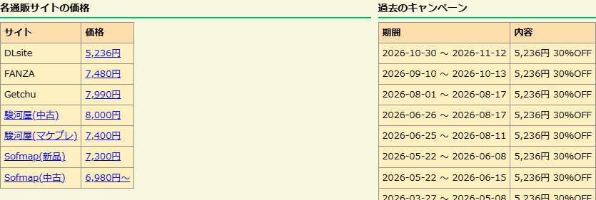

# 年齢確認の自動化の検証記録（1.1.2）

2026-11-07（日本時間）、Windows / Chromium 149 で確認しました。
18歳以上に限定して配布し、価格取得時の年齢確認と駿河屋のセーフサーチ設定を拡張が自動で行う仕様です。

## 初回の実サイト確認

Cookie が0件の新規ブラウザープロファイルに production ビルドを読み込み、批評空間のサノバウィッチのページを開きました。
通販サイトのタブを開く、確認ボタンを押す、批評空間を再読み込みする操作は行っていません。

| サイト | 表示された価格 |
| --- | --- |
| FANZA | 6,995円 |
| Getchu | 9,190円 |
| 駿河屋 | 中古6,000円、マケプレ5,386円 |
| ソフマップ | 中古5,480円～ |

通信記録では FANZA・ソフマップの年齢確認と、駿河屋の設定・年齢確認フォームの送信を確認しました。
駿河屋の設定値は「OFF・今回のみ」で、サイトの現在のフォーム識別子を使用します。
価格は確認時点の値です。

## 状態が変わる場合

- 確認済みのまま作品ページを再表示すると、確認処理を繰り返さず価格を取得。
- 確認状態を消去して Worker を停止し、次に作品ページを開いたときも自動で確認・価格取得。
- 新規プロファイルで2つの作品ページを同時に開いても、両方のタブに価格を表示。
- Summer Pockets REFLECTION BLUE でも、DLsite・FANZA・Getchu・駿河屋・ソフマップの7種類の価格と23件のキャンペーンを表示。

## 自動テスト

型チェック・45件のテスト・production ビルドが成功しました。
実応答を抽出したテストデータで、確認済み・未確認・別タブで確認済みになった場合・フォーム変更・取得失敗を検証しています。
確認先のホストとパス、POSTするフォームと設定値を限定し、確認が失敗しても無限に再送しません。
サイト側の障害や今後の構造変更で取得できない場合は、価格欄に取得失敗を表示します。
