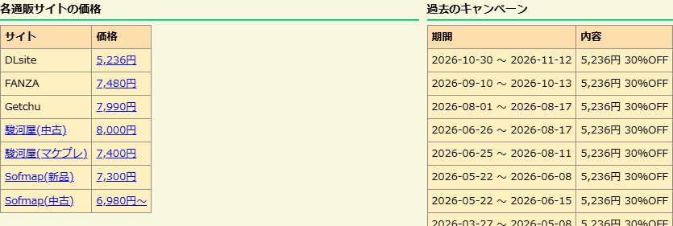

# 実サイト検証記録

検証日: 2026-11-07（日本時間）。Chromium 149 / Windows、Manifest V3 拡張 1.1.1 の production ビルド。
以下は検証時の値で、価格や在庫は変動します。

## 批評空間の実ページ

実際の作品ページに拡張を読み込み、通販への通信を置き換えずに確認しました。
FANZA・ソフマップはサイト上の年齢確認後、駿河屋はサイト上のセーフサーチ設定後のセッションを使用。

| 作品 | 確認結果 |
| --- | --- |
| [Summer Pockets REFLECTION BLUE](https://erogamescape.dyndns.org/~ap2/ero/toukei_kaiseki/game.php?game=29016) | DLsite 5,236円、FANZA 7,480円、Getchu 7,990円、駿河屋中古 8,000円・マケプレ 7,400円、Sofmap新品 7,300円・中古 6,980円～。過去キャンペーン23件。 |
| [サノバウィッチ](https://erogamescape.dyndns.org/~ap2/ero/toukei_kaiseki/game.php?game=21076) | FANZA 6,995円、Getchu 9,190円、駿河屋中古 6,000円・マケプレ 5,386円、Sofmap中古 5,480円～。過去キャンペーン17件。 |
| [CLANNAD](https://erogamescape.dyndns.org/~ap2/ero/toukei_kaiseki/game.php?game=3454) | Getchuは販売停止・在庫なし。駿河屋中古 12,000円、Sofmap中古 12,980円。キャンペーン該当なし。 |

表示したリンクが、それぞれ価格を取得した商品・中古一覧・マケプレ一覧を指すことも確認。
同名作品には版の違いがあるため、JAN コードで検索した商品の価格として扱っています。

## 追加の実応答確認

| 対象 | 確認結果 |
| --- | --- |
| [駿河屋・CLANNAD初回限定版](https://www.suruga-ya.jp/search?search_word=4933032002963&searchbox=1) | `￥4,080 ～ ￥6,600` の実応答を取得。解析と表示変換の回帰テストで `4,080～6,600円` を確認。 |
| [Amazon・CLANNAD](https://www.amazon.co.jp/dp/B000EIUQL6) | 実商品応答から5,316円を取得し拡張で表示。確認対象の批評空間3作品にはAmazonリンクがなかったため、批評空間形式の検証ページにリンクを置いて表示経路を確認。Amazonの通信は実サイトへの通信。 |
| [FANZA・割引中商品](https://dlsoft.dmm.co.jp/detail/cveaa_wws4zq2j/) | 販売価格8,530円を解析。通常価格8,980円・還元1,240ptを販売価格に混ぜないことを回帰テストで確認。 |
| FANZA従来の通販ページ | 販売中商品の9,880円を解析。CLANNADメモリアルエディションの販売終了ページでは値引額894円・参考価格6,380円を販売価格として扱わない。 |
| 年齢確認・セーフサーチ | 確認前の応答と設定後の応答を取得。確認前は在庫なしと決めつけず案内し、確認後は取得可能。駿河屋の検索結果404も設定案内を解析。 |

## 再起動・自動検証

- 実ページを表示した状態で Chrome DevTools Protocol の `ServiceWorker.stopWorker` を実行。
- `runningStatus: stopped` を観測してから批評空間を再読み込み。
- Worker が `running` に戻り、Summer Pockets の7種類の価格表示が復元。
- `npm run check`、`npm test`（32件）、`npm run build` が成功。依存パッケージ更新後の npm audit は指摘0件。
- HTML/JSON のテストデータは実応答の価格欄など必要な部分のみ抽出。テストは実サイトに通信しない。

## 確認範囲

全作品・すべての販売形態を網羅するものではありません。送料、会員限定価格、クーポン適用、ログイン後の個別価格は検証していません。
画像認証・サイト側の制限を回避する処理はありません。HTML 構造の変更や取得制限時は案内とリンクを表示します。
Chrome Web Store への公開およびストア配布版での検証は未実施です。
